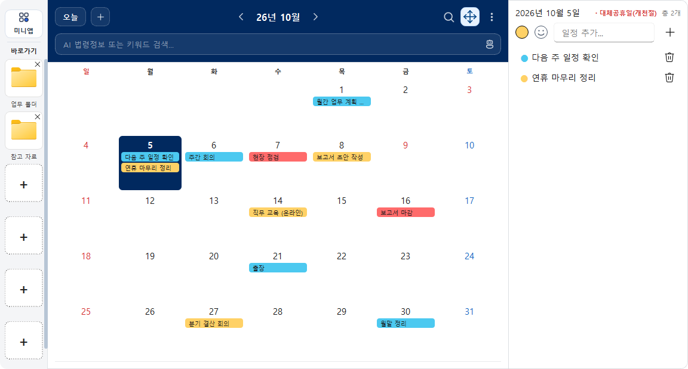

# 기후노트

Windows 바탕화면에서 쓰는 **오프라인 전용** 캘린더·메모·위젯 앱입니다.
일정과 메모를 이 PC에만 암호화해 저장하며, 외부 서버로 아무것도 보내지 않습니다.

## 받기

- 최신 실행 파일은 **[Releases](https://gitlab.aigov.go.kr/whrhkdrh/climate-note/-/releases)** 에서 받습니다. 설치 없이 실행하는 EXE 파일 하나입니다.
- 받은 파일은 릴리스 설명의 SHA-256과 비교할 수 있습니다: `Get-FileHash <파일명> -Algorithm SHA256`
- 처음 실행할 때 Windows SmartScreen 경고가 뜨면 `추가 정보` → `실행`을 누르세요. 코드 서명이 없어서 나타나는 경고입니다.

## 업데이트

- 실행 중인 기후노트를 트레이에서 **완전히 종료**한 뒤 새 EXE로 바꿔 실행합니다.
- 데이터는 `%LOCALAPPDATA%\MyDesktopCalendar\`에 그대로 남습니다. 초기화나 가져오기는 필요 없습니다.
- 데이터는 이 PC와 Windows 계정에 묶여 있습니다. 다른 PC로 옮길 때는 설정의 **내보내기/가져오기**를 쓰세요.
- v4.1로 처음 실행하면 데이터 형식이 바뀌고 한 번 안내창이 뜹니다. 그 뒤 v4.0a 이하 EXE를 실행하면 '데이터 보호를 위해 실행을 중단했습니다' 창이 뜨며 열리지 않습니다. 데이터 손상이 아니니 v4.1을 실행하고, 이전 EXE와 바로가기는 지워 주세요. 되돌리는 방법은 [README_detail.md](README_detail.md)의 다운로드 절에 있습니다.

## 주요 기능

- 캘린더(기본·중간·크게 3단계 크기), 일정·메모, 전역 검색
- 일정 시작 시각·알림·반복(매일·평일·매주·매월·매년)·여러 날 기간(v4.1)
- 스티키 노트, D-Day, 집중 모드(포모도로)
- 바로가기 사이드바, 미니앱(단위 환산·날짜/시간 계산·금액 표기·HWP → HWPX 변환)
- PIN 잠금, `Win+D`에도 남는 바탕화면 고정, 트레이 상주
- 공휴일·음력 데이터 내장(인터넷 연결 불필요)

## 요구 환경

Windows 10 이상(Windows 11 권장). Windows 전용입니다.

## 더 보기

- 기능 상세, 버전별 변경·검증, 소스 실행·테스트·빌드: **[README_detail.md](README_detail.md)**
- 개발 규칙: [AGENTS.md](AGENTS.md)

## 라이선스

GNU GPL v3.0 — [LICENSE](LICENSE). 제3자 구성요소 고지는 [licenses/](licenses/)에 있습니다.

설정 → 라이선스에서 구성요소별 원문과 출처를 오프라인으로 열람·복사할 수 있습니다. [기본 목록](licenses/components.json), [소스 제공 안내](licenses/APP-NOTICE.txt)를 참조하세요.

본 제품은 한컴의 HWP 문서 파일(.hwp) 공개 문서를 참고하여 개발하였습니다. 한글·HWPX 변환기는 별도 설치 제품으로 해당 사용권이 적용됩니다.

만든이: 기후에너지환경부 보문산불주먹
