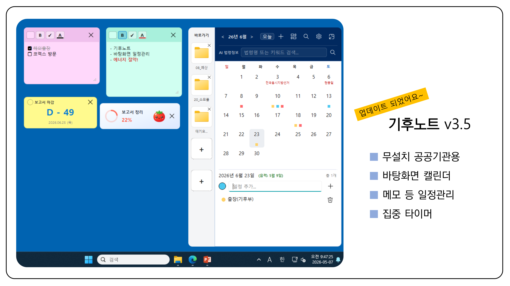
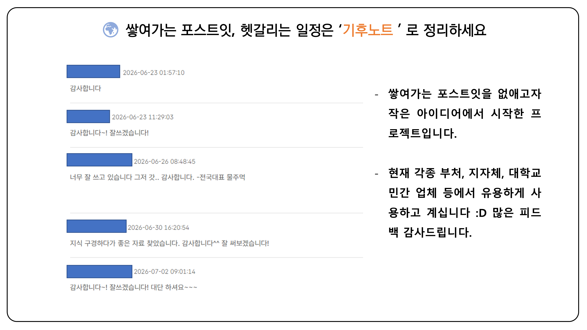
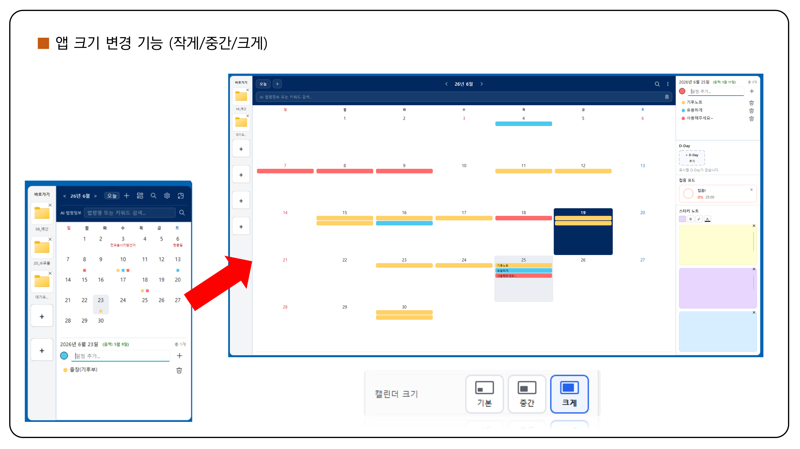
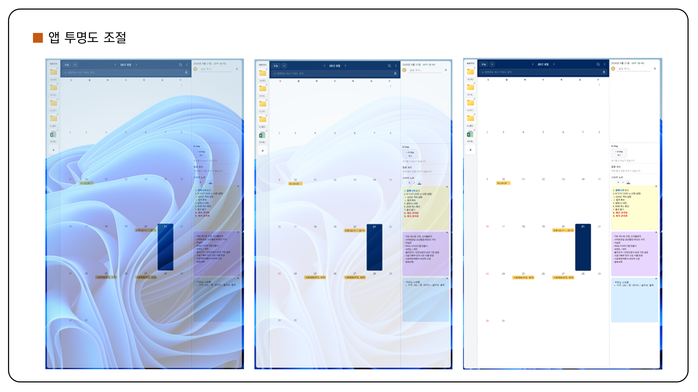
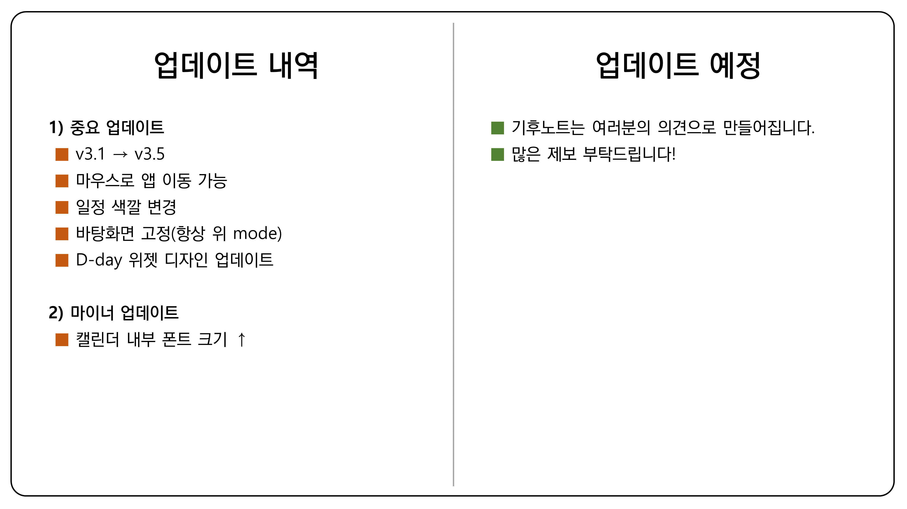

# 기후노트 상세 안내

> 짧은 소개와 받는 방법은 [README.md](README.md)에 있습니다. 이 문서는 버전별 변경·검증, 기능 상세, 소스 실행·테스트·빌드를 다룹니다.

Windows 바탕화면에서 쓰는 **오프라인 전용** 캘린더·메모·위젯 앱입니다.
일정과 메모를 하드웨어 바인딩 암호화로 로컬에만 저장하며, 외부 서버로 아무것도 보내지 않습니다.

현재 소스 버전 **v3.9a** (2026. 10. 9.)

> 아래 소개 슬라이드는 **v3.5 화면 기준**이며, 현재 소스 버전은 **v3.9a**입니다.












바탕화면에 캘린더 본체와 스티키 노트·D-Day·집중 모드 위젯을 따로 띄워 쓰는 구조입니다.
캘린더 왼쪽은 자주 쓰는 파일·폴더를 등록하는 바로가기 사이드바입니다.

---

## 다운로드

실행 파일은 **[Releases](https://gitlab.aigov.go.kr/whrhkdrh/climate-note/-/releases)** 페이지에서 받습니다.
**v3.9a는 v3.9에서 추가한 '화면 글자 따기' 미니앱에 사용법 안내를 더한 버전입니다.** 처음 화면과 결과 화면의 [사용법]에서 '영역 고르기 → 글자 읽기 → 표로 붙여넣기' 3단계 애니메이션을 볼 수 있고, [돌아가기]를 누르면 결과가 그대로 남아 있습니다. 화면 글자 따기는 복사할 수 없는 이미지·스캔 문서의 글자를 PC 안의 소형 AI 모델로 읽어 복사하며, 인터넷 연결이 필요 없고 결과를 저장하지 않습니다. 표는 칸을 유지해 한글·엑셀에 붙여넣을 수 있고, 불확실한 글자는 노란색으로 표시합니다(자동 수정 없음). 인식 모델이 포함되어 실행 파일이 약 94MB로 커졌습니다. 기존 데이터의 저장 형식과 암호화 방식은 그대로이며, 이전 버전에서 만든 데이터·백업·PC 이동 파일을 그대로 엽니다.
v3.8e까지의 기능도 모두 포함합니다. 서버 보안 검사 대응(XML 읽기·외부 호출 강화, cryptography 50.0.0), 바로가기 클릭 등록·이름 변경 종료 문제 수정, HWP → HWPX 문서 변환 미니앱, 최초 실행 크기 선택입니다. 처음 설치한 사용자는 기본·중간·크게 중 하나를 선택해 시작하며, 기존 사용자는 저장된 크기로 바로 열립니다. 문서 변환은 한글과 한컴 공식 HWPX 변환기가 설치된 PC에서 사용하며, XLS 등 다른 형식은 지원하지 않습니다.
로컬 최신 EXE는 `dist/기후노트_v3.9a.exe` (**93,874,139 bytes**)입니다. PowerShell `release` 실행 `20261009-132546-f2aab9b4b1`에서 **1,803개 테스트·새 빌드·격리 EXE 시나리오 3개**를 통과했습니다. 화면 글자 따기의 계약·걷어내기 절차는 [화면 글자 따기 계약](docs/SCREEN_TEXT.md), v3.9a 검증/배치/해시는 [사용법 안내 작업 기록](docs/work/2026-10-09-screen-text-usage-guide.md), v3.9 기록은 [화면 글자 따기 작업 기록](docs/work/2026-10-08-screen-text-capture.md), 이전 기록은 [보안 검사 2단계 기록](docs/work/2026-10-05-push-security-scan-step2.md)을 따릅니다.

```
SHA-256  ED4BBD6B15E6224028629A14F33C69DCB0CBAF936E2DB402EE2ED102E4790FDF
```

설치 과정이 없는 단일 실행 파일입니다. 원하는 위치에 두고 실행하면 됩니다.
기존 사용자는 실행 중인 기후노트를 완전히 종료한 뒤 새 파일로 교체하세요.
데이터는 `%LOCALAPPDATA%\MyDesktopCalendar\`에 그대로 유지됩니다.

v3.9a는 기존 DB v17·암호화 방식·설정 키·바로가기 6슬롯을 유지합니다.
버전 교체를 위해 데이터 초기화나 별도 가져오기를 실행할 필요는 없습니다.

> **처음 실행할 때 Windows SmartScreen 경고가 뜰 수 있습니다.** 코드 서명이 되어 있지 않기 때문입니다.
> `추가 정보` → `실행`을 누르면 진행됩니다.
> 받은 파일의 해시는 해당 릴리스 정보와 비교하세요. 위 v3.9a 빌드 확인 명령은 다음과 같습니다.
>
> ```powershell
> Get-FileHash 기후노트_v3.9a.exe -Algorithm SHA256
> ```

---

## 주요 기능

- **캘린더** — 기본·중간·크게 3단계 크기. 중간/크게에서는 날짜 칸에 일정이 색상 칩으로 표시됩니다
- **캘린더 이동** — 검색과 더보기 사이의 이동 토글로 세 크기 모두 이동/고정을 선택합니다. 기본 ON이며 재시작해도 유지됩니다
- **일정 이모지** — 색상 원과 같은 22px 테두리 스마일에서 이모지를 선택합니다
- **스티키 노트** — 서식·할 일 체크박스를 지원하는 바탕화면 메모. 닫으면 휴지통으로 이동해 복구할 수 있습니다
- **스티키 파일 링크(v3.7b)** — 문구 선택 후 연결 버튼 또는 파일 드롭으로 로컬 파일을 연결합니다. 작은 파일 종류 배지가 있는 둥근 라벨로 표시하며, Ctrl+클릭으로 엽니다. 정상 링크 뒤에는 짧은 간격만 두며, 다른 PC나 끊긴 연결은 점선·주의 표시에서 다시 연결할 수 있습니다. 파일 자체는 백업에 포함하지 않습니다. [라벨·간격 개선](docs/work/2026-09-20-sticky-link-spacing-fix.md)은 위 최신 EXE에 포함되어 있습니다
- **D-Day 위젯** — 최대 5개. 진한 커버색 카드로 남은 날짜를 표시합니다
- **집중 모드** — 포모도로 타이머 1개. 집중·휴식 세션을 기록합니다
- **바로가기 사이드바** — 자주 쓰는 파일·폴더 6개를 등록해 바로 실행합니다
- **미니앱 주머니** — 사이드바 최상단 버튼으로 앱 런처를 엽니다. 단위 환산기, 날짜·시간 계산기, 금액·숫자 표기 도우미, 문서 형식 변환(HWP → HWPX)을 제공하며, 다섯 번째로 화면 글자 따기(이미지·스캔 글자 인식, 표 모양 복사, PC 안 소형 AI 모델)를 제공합니다. 문서 변환에는 **한글과 한컴 공식 HWPX 변환기 설치**가 필요하며 원본/기존 결과를 보존합니다. XLS 등 다른 형식은 아직 지원하지 않습니다
- **전역 검색** — 일정과 메모를 한 번에 찾습니다
- **Privacy Lock** — PC 절전 해제나 Windows 잠금 해제 시 PIN을 요구합니다
- **바탕화면 고정** — `Win+D`(바탕화면 보기)를 눌러도 기후노트가 남습니다
- **트레이 상주** — 창을 닫아도 트레이에 남으며 `Ctrl+Shift+H`로 즉시 숨기고 꺼낼 수 있습니다

공휴일·음력 데이터는 앱에 내장되어 있어 인터넷 연결 없이 동작합니다.

---

## 요구 환경

- Windows 10 이상 (Windows 11 권장)
- Python 3.13 (개발·검증에 사용한 버전. 최소 지원 버전은 별도로 정해두지 않았습니다)

이 앱은 Windows 전용입니다. `winreg`, `msvcrt`, Win32 API를 직접 사용하므로 다른 OS에서는 동작하지 않습니다.

---

## 소스에서 실행 (개발자용)

```bash
git clone https://gitlab.aigov.go.kr/whrhkdrh/climate-note.git
cd climate-note

python -m venv .venv
.venv\Scripts\activate

pip install -r requirements.txt
python main.py
```

정확한 버전을 재현하려면 `requirements.txt` 대신 `requirements-lock.txt`를 사용합니다.

`.env` 파일은 필요하지 않습니다. 공휴일 데이터(`holidays.py`)가 저장소에 포함되어 있어
API 키 없이 실행·테스트·빌드가 모두 가능합니다.

---

## 테스트

v3.7부터는 [개발 하네스](docs/TESTING.md)를 기본 검증 경로로 사용합니다.
`requirements-lock.txt`와 일치하는 Windows / Python 3.13 가상환경에서 실행합니다.

```powershell
.\.venv\Scripts\python.exe tools/verify.py doctor
.\.venv\Scripts\python.exe tools/verify.py quick
.\.venv\Scripts\python.exe tools/verify.py quick --tests tests/test_ui_sticky.py
.\.venv\Scripts\python.exe tools/verify.py data
.\.venv\Scripts\python.exe tools/verify.py full
```

DB·암호화·UI·보안·스트레스를 포함한 500개 이상의 테스트가 있습니다.
실행별 격리 데이터와 검사 결과는 `output/harness/<run-id>/`에 보존합니다.
`summary.md`에서 결과를, `result.json`에서 입력 해시·환경·실행 명령을 확인합니다.
기존 `python -m pytest tests -q` 직접 실행도 지원합니다.

---

## 빌드

```powershell
.\.venv\Scripts\python.exe build_app.py     # 또는 build.bat
```

PyInstaller 단일 실행 파일이 `dist/기후노트_v3.9a.exe`로 생성됩니다.
파일명의 버전은 `app_info.py`의 `APP_VERSION`을 따릅니다.
`build.bat`도 같은 프로젝트 `.venv`를 사용합니다. 빌드 전에 Python 3.13·고정 의존성을 검사하고,
일치할 때만 같은 Python의 PyInstaller를 `--clean`으로 실행합니다. 패키지를 자동 설치하지 않습니다.

배포 전 자동 검증은 `.\.venv\Scripts\python.exe tools/verify.py release`로 실행합니다.
전체 테스트 후 **실행 전용 폴더에 새로 빌드한 EXE**를 합성 데이터로 검사합니다.
격리된 창이 잠시 표시되며 기존 `dist/`와 실사용 데이터는 보존합니다.
자동 통과와 [수동 배포 확인](docs/TESTING.md)은 별개이며 게시·업로드는 수행하지 않습니다.

---

## 프로젝트 구조

| 파일 | 역할 |
|---|---|
| `main.py` | 진입점. 단일 인스턴스 잠금, DB 초기화, 트레이, 전역 단축키 |
| `database.py` | SQLite CRUD, 스키마 마이그레이션, 백업, Export/Import |
| `security.py` | 키 유도, Fernet 암복호화, 경로 검증, 감사 로그 |
| `ui_main.py` | 메인 캘린더 창, 위젯 배치와 자동 정렬 |
| `ui_sticky.py` · `ui_dday.py` · `ui_focus.py` | 스티키 노트 · D-Day · 집중 모드 위젯 |
| `ui_settings.py` · `ui_search.py` · `ui_trash.py` | 설정 · 전역 검색 · 휴지통 창 |
| `show_desktop_guard.py` | `Win+D` 이후에도 창을 유지하는 Win32 레이어 제어 |
| `holidays.py` | 공휴일·음력 데이터 (생성물, `fetch_data.py`로만 갱신) |
| `diagnostics/` | 특정 PC 멈춤 현상 진단 도구 |

`large` 모드에서는 오른쪽에 일정·D-Day·집중·스티키 미니 패널이 나타나고,
떠 있던 위젯은 숨겨진 뒤 패널과 동기화됩니다.

---

## 데이터 저장 위치

```
%LOCALAPPDATA%\MyDesktopCalendar\
  calendar.db      SQLite 데이터베이스
  .salt            암호화 키 유도용 salt
  backups/         자동 백업 (.cnbak)
  error.log        오류 로그
```

데이터는 **PC와 Windows 계정에 묶여 있습니다.** 하드웨어 정보와 사용자명으로 키를 유도하기 때문에
`calendar.db`만 다른 PC로 옮기면 열리지 않습니다. PC를 옮길 때는 설정의 **내보내기/가져오기**를 사용하세요.

---

## 개발 참여

코드를 고치기 전에 **[`AGENTS.md`](AGENTS.md)를 반드시 읽어주세요.** 이 프로젝트의 규칙이 모두 여기 있습니다.

특히 다음 두 가지는 예외 없이 지켜야 합니다.

- **기존 사용자 데이터는 반드시 보존됩니다.** 스키마 변경은 `ALTER TABLE ... ADD COLUMN`만 허용하며
  테이블·컬럼 삭제와 재생성은 금지입니다. 데이터가 바뀌는 기능에는 왕복 검증 테스트를 함께 추가합니다.
- **보안 코딩 규칙**([`docs/CODING_STANDARDS.md`](docs/CODING_STANDARDS.md))을 따릅니다.
  `bare except` 금지, `except` + `pass` 단독 금지, 파일은 `with open`, DB는 `_connection()` 사용.

| 문서 | 내용 |
|---|---|
| [`AGENTS.md`](AGENTS.md) | 핵심 개발 규칙, 작업별 필수 문서, 완료 기준 |
| [`docs/ARCHITECTURE.md`](docs/ARCHITECTURE.md) | 데이터 흐름, 보안, DB 스키마 |
| [`docs/UI_PATTERNS.md`](docs/UI_PATTERNS.md) | UI 컴포넌트 패턴과 색상 |
| [`docs/TESTING.md`](docs/TESTING.md) | 하네스 명령, 테스트 구조, 수동 배포 확인 |
| [`docs/RELEASE_HISTORY.md`](docs/RELEASE_HISTORY.md) | 과거 검증 증빙, 미해결 조사·보류 과제 |
| [`docs/templates/WORK_NOTE.md`](docs/templates/WORK_NOTE.md) | 여러 단계 개발 작업의 진행·검증·인계 양식 |
| [`docs/CODING_STANDARDS.md`](docs/CODING_STANDARDS.md) | 행안부 CODEMIND 5개 보안 규칙 |

---

## 라이선스

이 프로젝트는 **GNU General Public License v3.0**을 따릅니다. 전문은 [`LICENSE`](LICENSE)를 참조하세요.

UI 프레임워크로 사용하는 `PySide6-Fluent-Widgets`가 GPLv3이므로, 이를 사용하는 기후노트도
같은 조건으로 배포됩니다.

번들된 제3자 구성요소와 각 라이선스 원문은 [`licenses/`](licenses/)에 있습니다.

앱의 **설정 → 라이선스**에서 구성요소별 출처와 원문을 인터넷 연결 없이 읽고 복사할 수 있습니다. 화면 글자 따기를 포함한 배포본은 PaddleOCR 모델·한국어 사전, ONNX Runtime 및 NumPy 고지도 함께 제공합니다. 모델 가중치를 자체 학습한 것으로 표시하지 않으며 [모델 출처](screen_text/licenses/MODEL-ATTRIBUTION.txt)와 [기본 구성요소 목록](licenses/components.json)을 참조하세요.

본 제품은 한컴의 HWP 문서 파일(.hwp) 공개 문서를 참고하여 개발하였습니다.

문서 형식 변환은 별도 설치된 한글과 공식 HWPX 변환기를 이용하며 해당 제품의 사용권은 별도로 적용됩니다. 기후노트는 한컴 엔진이나 설치 프로그램을 포함하지 않습니다. [한컴 명세 사용권](https://www.store.hancom.com/support/downloadCenter/hwpOwpml)

소스 저장소는 기관 내부 GitLab이므로 외부 수령자의 접근은 별도로 확인해야 합니다. 배포자는 전달한 EXE와 일치하는 소스·빌드 자료 및 필요한 의존 구성요소의 대응 소스를 제공할 경로를 함께 안내해야 합니다. [소스 안내](licenses/APP-NOTICE.txt)

만든이: 기후에너지환경부 보문산불주먹
